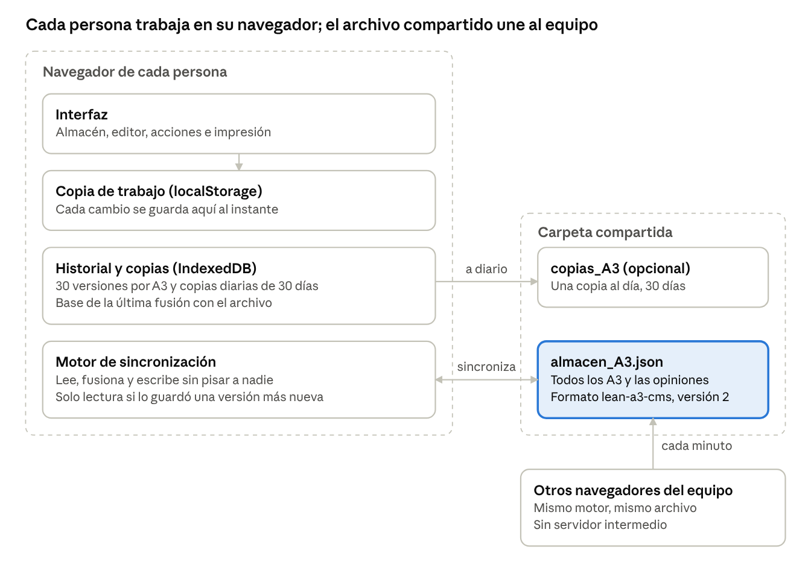

# Especificación funcional · Lean A3 Solver

10/11/2026 · versión de la aplicación 1.11.0

## 1. Objeto y alcance

Lean A3 Solver es una aplicación web para elaborar, revisar y seguir informes A3 de resolución de problemas según la metodología Lean A3. Este documento describe qué hace la versión 1.11.0 y con qué reglas; el uso paso a paso está en el [Manual de uso](Manual-de-uso.md).

**Dentro del alcance:**

- Almacén de A3 con filtros, indicadores y papelera.
- Editor de los 7 pasos del A3, en vista de lámina o en asistente paso a paso.
- Herramientas de análisis: 5W+1H, 5 Por Qués, Ishikawa 6M, matriz impacto/esfuerzo e indicador con gráfico.
- Revisión con comentarios por paso y aprobación.
- Seguimiento transversal de las acciones y de las opiniones del equipo sobre la app (hasta la versión que las incluye), con exportación a Excel.
- Impresión en DIN A3 horizontal y exportación HTML.
- Trabajo en equipo mediante un archivo compartido, con fusión de cambios, copias de seguridad e historial.

**Fuera del alcance (v1.11.0):** usuarios con contraseña y permisos (pendiente de IT), edición simultánea en tiempo real, servidor central e integración con otros sistemas de la empresa.

## 2. Usuarios y roles

No hay cuentas: cada persona indica su nombre una vez en su equipo y ese nombre firma sus cambios. Los roles son funcionales, no permisos: cualquiera puede hacer cualquier acción.

| Rol | Quién es | Qué hace en la app |
| --- | --- | --- |
| Autor / líder del A3 | Responsable de resolver el problema | Crea el A3, completa los 7 pasos, registra mediciones y pide revisión |
| Revisor | Mando o facilitador Lean designado por el autor | Comenta pasos, devuelve con comentarios o aprueba |
| Responsable de acción | Persona asignada a una contramedida | Consulta sus acciones y cambia su estado desde Acciones |
| Equipo | Resto de usuarios del almacén compartido | Consulta A3, deja opiniones sobre la app |

El nombre se guarda en el navegador de cada equipo (no en el archivo compartido). Si dos personas usan el mismo nombre, la app no puede distinguirlas.

## 3. Arquitectura y almacenamiento

No hay servidor: la app es un único archivo HTML que se ejecuta en el navegador, y el equipo comparte los datos a través de un archivo JSON en una carpeta (de red o local).

Cada cambio se guarda primero en el navegador y, si hay archivo vinculado, el motor de sincronización lo lleva al archivo y recoge lo de los demás. Sin archivo vinculado, los A3 solo existen en ese navegador y la app recuerda descargar una copia.

| Dónde | Qué guarda | Compartido |
| --- | --- | --- |
| Archivo del almacén (.json) | Todos los A3 y las opiniones | Sí, con quien tenga acceso a la carpeta |
| Navegador: localStorage | Copia de trabajo, nombre del usuario, tema | No |
| Navegador: IndexedDB | Historial, copias diarias, base de fusión, referencia al archivo | No |
| Carpeta copias_A3 (opcional) | Una copia al día durante 30 días | Según la carpeta |

El acceso al archivo usa la API de acceso a archivos del navegador (Chrome y Edge). El navegador pide permiso al vincularlo y, a veces, al volver a abrir la app.

## 4. Módulos funcionales

La app tiene cinco vistas (Almacén, Acciones, A3 en edición, Opiniones y Guía) y varias ventanas de apoyo. En el móvil se navega con una barra inferior.

### 4.1 Almacén de problemas

- Tarjeta por A3: estado, título, líder, área, última modificación y autor, avance (pasos rellenos x/7 y, cuando están todos, «Falta autoevaluar» o «Validado»), mini-gráfico del indicador frente a la meta y acciones hechas.
- Una sola barra con la búsqueda (título, líder o proceso), los estados con su recuento (Todos, Abiertos, En progreso, Estandarizados) y, solo cuando hay alguno, los filtros En revisión y Sin actualizar en más de 30 días y el acceso a las acciones vencidas o pendientes. Los filtros de área y líder aparecen cuando hay más de uno.
- Acciones por tarjeta: abrir, imprimir, clonar, descargar (.json) y enviar a la papelera.
- Crear A3 nuevo (se abre en el asistente), importar A3 desde .json, exportar todo y cargar el ejemplo completo.
- Papelera: los A3 eliminados se pueden restaurar durante 30 días; después se borran definitivamente.

### 4.2 Editor del A3

Cabecera: título, líder, área, fecha y estado. Barra del editor: estado de guardado, cambio Lámina/Asistente, avance (Pasos x/7 y, con todo relleno, el aviso de autoevaluación) con desglose por paso, resumen de revisión, Imprimir, Historial y volver al Almacén.

| Paso | Contenido | Herramientas |
| --- | --- | --- |
| 1. Contexto | Por qué importa el problema (SQDC) | Guía Sensei, criterios de calidad |
| 2. Situación actual | Hechos y datos del problema | Herramienta 5W+1H con «sintetizar al texto» |
| 3. Objetivo SMART | Meta cuantificable y plazo | Criterios de calidad |
| 4. Causa raíz | Análisis y causas raíz marcadas | 5 Por Qués (árbol) o Ishikawa 6M, conclusiones |
| 5. Contramedidas | Plan de acción: qué, quién, cuándo, estado | Fichas enlazadas a causas raíz, matriz de priorización |
| 6. Verificación | Resultado frente a la meta | Indicador con mediciones y gráfico; antes / meta / resultado |
| 7. Estandarización | Estándar, formación y despliegue horizontal | Criterios de calidad |

Cada paso de la lámina tiene tres ayudas: Guía Sensei (preguntas clave y ejemplos), Criterios de calidad (casillas de autoevaluación) y comentarios de revisión. Cualquier paso se puede ampliar a pantalla completa (modo foco).

### 4.3 Asistente

Muestra un paso cada vez con su guía, sus criterios y sus comentarios al lado, y botones Anterior / Siguiente. Los A3 nuevos se abren en el asistente; los existentes, en la lámina.

### 4.4 Herramientas de análisis

- **5W+1H:** seis campos (qué, dónde, cuándo, quién, por qué, cuánto) que se pueden volcar como texto de la situación actual.
- **5 Por Qués:** árbol de causas con ramas; cada nodo se puede marcar como causa raíz.
- **Ishikawa 6M:** espinas por categoría, causas y subcausas; cualquier causa o subcausa se puede marcar como causa raíz. El diagrama se compacta solo en espacios estrechos.
- **Matriz de priorización:** cuatro cuadrantes (Rápidas y eficaces, Estratégicas, Menores, Descartar) para clasificar las contramedidas por impacto y esfuerzo.
- **Indicador:** nombre, unidad, sentido (subir o bajar), línea base, meta y mediciones fechadas con comentario; gráfico con meta y base, y aviso de si la última medición cumple.

### 4.5 Revisión

El autor solicita revisión a un revisor con una nota opcional. El revisor comenta pasos concretos, devuelve con comentarios o aprueba. Los comentarios se marcan como resueltos. Un banner avisa al revisor de los A3 pendientes de su revisión.

### 4.6 Seguimiento de acciones

Lista única de las contramedidas de todos los A3: pendientes por defecto, ordenadas por plazo, con retraso indicado. Filtros por estado, «vencen en 7 días», responsable y «Mis acciones». Cambio de estado en la propia lista, enlace al A3 y exportación CSV para Excel.

### 4.7 Impresión

Vista previa de la lámina DIN A3 horizontal (420 × 297 mm) con zoom, impresión o guardado en PDF desde el navegador y descarga de un HTML imprimible autónomo.

### 4.8 Seguridad de los datos

- **Historial:** hasta 30 versiones por A3, como mucho una cada 10 minutos de edición; restaurar guarda también la versión actual.
- **Copias diarias:** una al día en el navegador y, si se elige, en una carpeta; se conservan 30 días.
- **Exportar todo:** descarga del almacén completo en .json.

### 4.9 Opiniones y mejoras

Vista propia (barra superior y barra inferior en el móvil) para los fallos, mejoras y dudas del equipo sobre la app:

- Alta: tipo (Fallo, Mejora, Duda) y texto; se anotan autor, fecha y desde dónde se escribió (almacén, acciones o el A3 abierto).
- Seguimiento: Nueva → En estudio → Planificada (con versión prevista) → Hecha (con versión en que se hizo) o Descartada; respuesta del equipo en cada una.
- Al marcar Hecha se anota la versión prevista o, si no hay, la versión actual de la app. Las planificadas para la versión actual o anteriores se avisan para marcarlas.
- Filtros por estado y tipo, búsqueda, lista de lo hecho agrupado por versión y exportación CSV para Excel.
- El contador de la barra superior muestra las nuevas. Cada cambio queda firmado (quién y cuándo) y se fusiona entre personas como el resto del almacén.

### 4.10 Otras funciones

Avisos del navegador opcionales (revisiones y acciones vencidas), modo oscuro y glosario de términos Lean en los textos.

## 5. Reglas de negocio

### 5.1 Estado del A3

Tres estados que elige el autor: Abierto, En progreso y Estandarizado. La app no los cambia sola. Un A3 «sin actualizar» es uno sin cambios en más de 30 días.

### 5.2 Avance y criterios de calidad

El avance es un solo indicador en dos fases. Primero, **Pasos (x/7)**: cuántos pasos tienen contenido mínimo. El desglose de la barra del editor incluye además la identificación (título distinto de «Nuevo Problema A3», líder y área). Cada etapa cuenta si cumple su mínimo:

| Etapa | Cuenta como rellena si… |
| --- | --- |
| Identificación | Hay título propio, líder y área |
| 1. Contexto | Más de 15 caracteres |
| 2. Situación actual | Más de 15 caracteres o algún campo 5W+1H |
| 3. Objetivo | Más de 15 caracteres |
| 4. Causa raíz | Al menos una causa marcada como raíz |
| 5. Contramedidas | Al menos una acción con texto, responsable y fecha |
| 6. Verificación | Más de 15 caracteres o al menos una medición del indicador |
| 7. Estandarización | Más de 15 caracteres |

Después, la **autoevaluación con los criterios de calidad** (18 casillas repartidas por los pasos). Con los 7 pasos rellenos, el A3 muestra «Falta autoevaluar (x/18)» hasta marcarlas todas y entonces «Validado».

### 5.3 Revisión

| Estado | Se llega… | Siguiente paso posible |
| --- | --- | --- |
| Borrador | Al crear el A3 | Solicitar revisión (con revisor) |
| En revisión | Al solicitarla | Devolver con comentarios o aprobar |
| Devuelto con comentarios | Lo decide el revisor | Volver a solicitar revisión |
| Aprobado | Lo decide el revisor | Reabrir; si el A3 cambia después, se avisa |

Cada movimiento queda registrado con persona, fecha y nota.

### 5.4 Contramedidas y causas raíz

- Cada contramedida puede atacar una causa raíz del paso 4. El enlace se guarda por identificador; el texto «[#n] …» se calcula al mostrarlo, así que renombrar o reordenar causas no modifica las acciones.
- También se puede escribir una causa a mano (sin enlace) o quitarla.
- Las causas sin contramedida se marcan en ámbar; «Añadir las que faltan» crea una fila por cada una. No se crean solas: abrir un A3 no lo modifica.
- Una acción está vencida si no está hecha y su plazo es anterior a hoy.

### 5.5 Guardado y trabajo en equipo

- El editor guarda solo 1 segundo después del último cambio, con Ctrl+S, al salir y al cerrar la pestaña.
- Con almacén en archivo, cada cambio se escribe en el archivo; los cambios de otras personas se recogen al volver a la ventana y cada minuto.
- La fusión es por A3, por apartado y por elemento (cada acción, medición o causa). Solo se pregunta cuando dos personas cambiaron lo mismo, indicando qué apartados.
- La app nunca escribe encima de un archivo que ha cambiado desde que lo leyó: lo vuelve a leer y fusiona, aunque la pregunta se conteste tarde.
- Si faltan 3 o más A3 en el archivo sin haber pasado por la papelera, se pregunta antes de aceptarlo.
- Si el archivo lo guardó una versión más nueva de la app, esta copia pasa a solo lectura y no escribe en él.
- Un archivo vacío o ilegible no se toca; el usuario decide si sustituirlo con los A3 de su navegador o recuperar una copia.

### 5.6 Autoría

Cada guardado del editor anota quién y cuándo («Modificado por…»). Mirar un A3 sin cambiar nada no altera ni la fecha ni el autor.

## 6. Modelo de datos y formato del archivo

El almacén es un único archivo JSON con este contenido de primer nivel:

| Clave | Contenido |
| --- | --- |
| `formato` | Siempre `lean-a3-cms` |
| `version` | Versión del formato de datos (actual: 2) |
| `appVersion` | Versión de la app que lo guardó (p. ej. 1.9.0) |
| `guardadoEn` | Fecha y hora del guardado |
| `proyectos` | Lista de A3 (incluidos los de la papelera) |
| `opiniones` | Opiniones del equipo sobre la app: tipo, texto, autor, fecha, estado, versión prevista, versión en que se hizo y respuesta |

Las claves que esta versión no conoce se conservan al escribir, para no borrar datos de versiones futuras.

**Cada A3 contiene:**

| Grupo | Campos |
| --- | --- |
| Identificación | `id`, `title`, `owner` (líder), `department` (área), `date`, `status` |
| Pasos 1–3 | `background`, `currentCondition`, `w5h1` (qué, dónde, cuándo, quién, por qué, cómo), `goals` |
| Paso 4 | `rootCauseMode` (árbol o Ishikawa), `rootCauseTree`, `rootCauseIshikawa`, `rootCauseConclusions` |
| Paso 5 | `countermeasures` (notas), `actionItems`: acción, responsable, plazo, estado, causa enlazada (`linkedRootCauseId` + texto de respaldo), impacto y esfuerzo |
| Paso 6 | `check`, `beforeMetric`, `targetMetric`, `afterMetric`, `indicator` (nombre, unidad, sentido, base, meta, mediciones) |
| Paso 7 | `followUp` |
| Calidad | `qualityChecks` (criterios de calidad marcados) |
| Revisión | `review` (estado, revisor, historial), `comments` (por paso, resueltos o no) |
| Trazabilidad | `createdBy`, `updatedAt`, `updatedBy`, `deletedAt`, `deletedBy` |

Al leer el archivo o el navegador, cada A3 se valida y repara: se completan campos que faltan, se corrigen tipos y se resuelven identificadores duplicados, sin perder campos desconocidos.

**Fuera del archivo** (en cada navegador): copia de trabajo de los A3, nombre del usuario, tema, historial de versiones, copias diarias y la referencia al archivo vinculado.

## 7. Requisitos no funcionales

| Área | Requisito en la v1.11.0 |
| --- | --- |
| Distribución | Un único archivo HTML, sin instalación ni servidor; también publicado como artefacto de Claude para el móvil |
| Navegadores | Chrome y Edge: todo. Firefox y Safari: todo salvo guardar en archivo (los A3 quedan en el navegador) |
| Sin conexión | Funciona sin red; no usa servicios externos ni IA |
| Privacidad | Los datos no salen del navegador o del archivo elegido por el usuario |
| Rendimiento | 200 A3 (≈ 1,4 MB): el almacén se muestra en menos de 3 s y el buscador responde en menos de 150 ms por tecla |
| Pantallas | Escritorio y móvil (390 px) sin desplazamiento horizontal; navegación inferior en el móvil |
| Accesibilidad | Uso con teclado, foco visible, ventanas con foco atrapado y Escape, contraste comprobado en claro y oscuro |
| Robustez | Pantalla de error con descarga de emergencia en vez de página en blanco; datos validados al leer |
| Calidad | Unas 400 comprobaciones automáticas (lógica, navegador, móvil, concurrencia, CPU ralentizada ×4) en cada envío a GitHub |

## 8. Limitaciones conocidas y pendientes

| Limitación | Consecuencia | Salida prevista |
| --- | --- | --- |
| Sin usuarios ni permisos | Cualquiera puede editar o borrar cualquier A3 y firmar con cualquier nombre | Autenticación con IT |
| Archivo compartido, no base de datos | Sin edición en tiempo real; los cambios ajenos tardan hasta 1 minuto | Servidor central si el uso crece |
| Una copia del HTML por persona | Versiones distintas en el equipo; la 1.7.0 no tiene solo lectura | Actualizar a la vez a la 1.8.x o superior |
| Guardar en archivo solo en Chrome/Edge | En Firefox o Safari los A3 no se comparten | Usar Chrome o Edge |
| Nombre de usuario por navegador | Dos personas con el mismo nombre no se distinguen | Autenticación con IT |
| Enlaces antiguos por texto | Los A3 anteriores a la 1.9.0 conservan el texto «[#n] …» guardado (se muestra bien) | Se limpia al volver a enlazar la causa |
